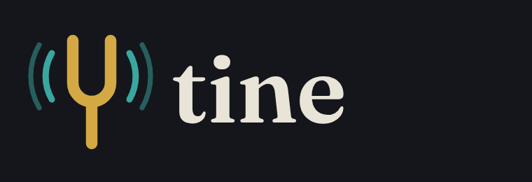

<p align="center"></p>

# Tine

**A programming language for music.** Write grooves and melodies in a few characters, perform them live with MIDI gear, and compose finished pieces with sections and form. Microtonal tunings and arbitrarily complex rhythm are built in, and every random choice is seeded, so anything you hear can be played again exactly.

```tine
tempo 96
key d dorian

voice drums = {[kick . . kick . . snare .] [hat*8].vel([.9 .5])}
voice bass  = [^1 . ^1 ^5 . ^4 _ ^b3].octave(-2).inst(bass)
voice keys  = <^1@7 ^4@7 ^5@7 ^1@9>.strum.vel(.55)
voice tune  = [^5 ^3|^4 . ^1 ^2 _ ^3|^7 .]
  .every(4, rev)
  .inst(pluck)
```

## What's here

| | |
| --- | --- |
| **Language** | `src/core`: parser, interpreter, exact-time patterns, seeded randomness, pitch and tuning model, chord symbols, lead-sheet changes and jazz voicings, WAV, MIDI and MusicXML writers, and its own engraver for chord charts, lead sheets and scores |
| **Sound** | built-in instruments, a general synth with ten presets (`tb303`, `supersaw`, `reese`, `wobble`, `fm`...), about 200 bundled CC0 samples with chop, slice, loopAt and cut groups, sample packs by URL (`strudel.json`, `github:`), thirteen per-voice effects, SoundFont 2 playback, and SuperDirt output over OSC (`.dirt()`, `tine dirt`) |
| **REPL** | `tine`: multi-line input, tab completion, piano-roll drawings in the terminal, `:play`, `:seed`, `:save` |
| **DAW** | `tine daw piece.tine`: live coding in the browser with bar-quantized hot swap, mute/solo, sections as launchable scenes, MIDI in/out with control and program changes, MIDI clock in and out, controller mapping, performance toggles, per-voice effects on the audio thread, synthesis in a background thread, a sample browser, a live chord chart, lead sheet and score of the code, capture of played notes into code, sample loading, a history of every take with its seed, WAV/MIDI export |
| **Tutorial** | `tine learn`: 17 interactive lessons for programmers new to music, with live examples and a checked exercise in each |
| **Theory course** | `tine theory`: a jazz-first college theory sequence, 101 through 202, in 35 lessons with live examples, challenges checked by what your code plays, and quizzes with ear training |
| **Packaging** | standalone `tine` binaries for Linux, macOS and Windows; `tine pack` turns one piece into a single-file HTML player or its own executable |
| **Editors** | a language server (`tine lsp`), a VS Code extension, and support files for Neovim, Vim, Helix, Emacs, Sublime, JetBrains and Zed (`editors/`) |
| **Brand** | logo, icons and palette in `brand/` |
| **Docs** | `docs/REFERENCE.md` (the whole language), `docs/DESIGN-DECISIONS.md` (why it is the way it is) |
| **Examples** | `examples/`: a groove, a song with form, microtonal tunings, polyrhythm, generative music, a live MIDI set |

## Install

Download the binary for your machine from `dist/bin/` (or a release), rename it to `tine`, and put it on your PATH. It has no dependencies: the DAW, the tutorial, the theory course and the language server are inside it.

| Platform | File |
| --- | --- |
| macOS, Apple silicon | `tine-darwin-arm64` |
| macOS, Intel | `tine-darwin-x64` |
| Linux x64 / arm64 | `tine-linux-x64` / `tine-linux-arm64` |
| Windows | `tine-windows-x64.exe` |

On macOS, a downloaded binary may need `xattr -d com.apple.quarantine tine` before it runs.

From source, with [Bun](https://bun.sh): `bun install`, then `bun src/cli/main.ts`. `bun run build` produces the web apps and all five binaries; `bun test` runs the test suite.

## Quick start

```sh
tine new groove            # a starting point
tine daw groove.tine       # open the live DAW (Chrome/Edge for MIDI)
tine learn                 # the tutorial
tine theory                # the music theory course
tine render groove.tine    # groove.wav
tine midi groove.tine      # groove.mid, one track per voice, for any other DAW
tine xml groove.tine       # groove.musicxml, a score for MuseScore, Dorico, Sibelius
tine chart groove.tine     # groove.chart.html, a chord chart to print
tine lead groove.tine      # groove.lead.html, a lead sheet: melody and chords
tine score groove.tine     # groove.score.html, sheet music for every voice
tine pack groove.tine      # groove.html, plays anywhere
tine pack groove.tine --exe   # ./groove, its own executable
```

Edit the file in your own editor while the DAW is open: every save is heard on the next bar.

## The language in one screen

```tine
-- phrases divide a bar: rests, holds, weights, nesting
voice a1 = [c . e _ g:2 [a b c5]]
-- together, in turn, by chance
voice a2 = {[kick*4] [. snare]*2 [hat*8].degrade(.2)}
voice a3 = [c <e eb> g|a|b c5?]
-- keys and degrees, chords by name or by degree
key a minor
voice a4 = <^1@9 ^4@7 ^5@7>.arp("updown").fast(2)
-- microtones: cents, equal divisions, ratios, Hz, Scala files
voice a5 = [c4 (c4 + 50c) (c4 + 5\31) (c4 * 7/4) 432hz]
-- functions and logic; any function chains with a dot
let fill(p) = p.fast(2).vel(.6)
voice a6 = [kick . snare .].every(4, fill)
voice a7 = per_bar(n => [c e g].transpose(n % 4 * 2))
-- composing: sections and form
section verse 8
  voice bass = [^1 . ^5 .].octave(-2).inst(bass)
form verse verse
```

See the [reference](docs/REFERENCE.md) for everything, and [design decisions](docs/DESIGN-DECISIONS.md) for the reasoning.

## License

MIT. The bundled samples are CC0 (public domain): see `assets/samples/CREDITS.md`.
